# BiNumreGenerator – hjælp og dokumentation

BiNumreGenerator laver startnumre til orienteringsløb ud fra en startliste: enkeltløb, stafet og
flerdagesløb. Startnumrene udskrives direkte på en printer eller gemmes som PDF – i A5, to på hvert
A4-ark eller ét pr. side.

Programmet er lavet til Windows og kører uden installation. Hjælp, nyheder og nye versioner findes
på **https://orientering.palsgaard.net**.

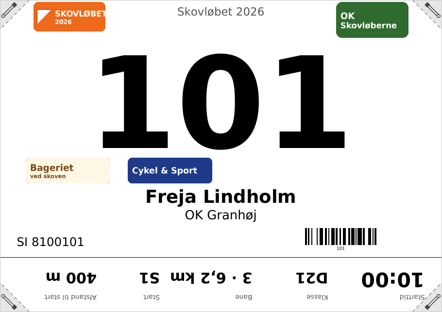

---

## Indhold

1. [Kom i gang](#1-kom-i-gang)
2. [Vælg løbstype](#2-vælg-løbstype)
3. [Startlisten](#3-startlisten)
4. [Opsætning af løbet](#4-opsætning-af-løbet)
5. [Design af startnummeret](#5-design-af-startnummeret)
6. [Logoer og sponsorer](#6-logoer-og-sponsorer)
7. [Udskriv og PDF](#7-udskriv-og-pdf)
8. [Projektfilen – gem, åbn og giv videre](#8-projektfilen--gem-åbn-og-giv-videre)
9. [Flerdagesløb i detaljer](#9-flerdagesløb-i-detaljer)
10. [Stafet i detaljer](#10-stafet-i-detaljer)
11. [Sprog](#11-sprog)
12. [Spørgsmål og fejlfinding](#12-spørgsmål-og-fejlfinding)
13. [Kommandolinje (for øvede)](#13-kommandolinje-for-øvede)
14. [Ophavsret, licenser og sikkerhed](#14-ophavsret-licenser-og-sikkerhed)
15. [For udviklere](#15-for-udviklere)

---

## 1. Kom i gang

### Hent programmet
Hent den nyeste udgave fra hjemmesiden. Pakken er en zip-fil, der indeholder:

| Mappe / fil | Indhold |
|---|---|
| `Start BiNumreGenerator.bat` | Starter programmet |
| `Program\BiNumreGenerator.exe` | Selve programmet – Java følger med, intet skal installeres |
| `Installation\BiNumreGenerator-x.y.z.msi` | Installationsfil, hvis du hellere vil installere (du vælger selv genvej i startmenuen og på skrivebordet; kræver ikke administrator) |
| `Testfiler\` | Eksempler på startlister, et logo og en projektfil |
| `TESTVEJLEDNING.txt` | Trin-for-trin afprøvning af funktionerne |
| `LICENS.txt`, `Licenser\` | Ophavsret og licenser |

**Pak hele zip-filen ud først** (højreklik → *Udpak alle*). Programmet kan ikke køre inde fra
zip-filen.

### Første start
Windows viser måske *"Windows beskyttede din pc"*, fordi programmet ikke er kodesigneret. Klik
**Flere oplysninger** → **Kør alligevel**. Det sker kun første gang.

### Arbejdsgangen kort
1. Vælg løbstype på startskærmen.
2. Indlæs startlisten (fil eller OFeed).
3. Ret opsætningen: løbets navn, afstand til start, etaper, farver.
4. Tilpas designet og sæt logoer og sponsorer på.
5. Udskriv – eller gem som PDF.
6. Gem projektet, så alt kan åbnes igen eller gives videre.

Programmet har en menu i venstre side: **Startliste**, **Opsætning** og **Design**, og nederst
**Nyt løb**, **Hjælp** og **Om**. Øverst er **Åbn**, **Gem**, **Gem som…**, **Eksportér PDF** og
**Udskriv**. Nederst i vinduet står antal startnumre, hvor mange der mangler et nummer, og hvor mange
der ikke er udskrevet endnu.

---

## 2. Vælg løbstype

Programmet starter med valget af løbstype:

| Løbstype | Startnummeret |
|---|---|
| **Enkeltløb** | Ét startnummer pr. løber med starttid, klasse, bane, start og afstand til start. |
| **Stafet** | Holdets ture har samme nummer. Turen står i et farvet bånd ("Tur 1", "Tur 2" …) med én farve pr. tur. Kun 1. tur har starttid. |
| **Flerdagesløb** | Samme nummer alle dage. I bunden en kasse pr. etape med etapens starttid, klasse, bane, start og afstand. Vælg antal etaper (1–10) på kortet. |

Løbstypen og antallet af etaper kan ændres senere under **Opsætning**.

Du kan også klikke **Åbn gemt projekt…** for at fortsætte med et løb, du har gemt før.

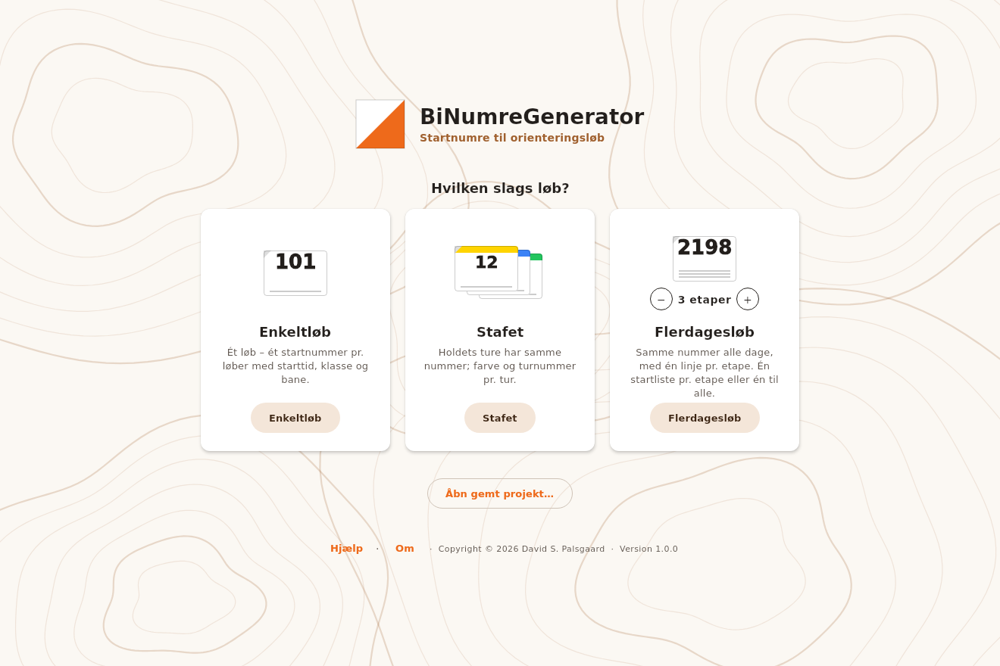

---

## 3. Startlisten

### Filformater
| Format | Typisk fra | Bemærkninger |
|---|---|---|
| **IOF XML 3.0** (StartList) | MeOS, OE, Eventor | Individuelle løb og stafet. Flere etaper i én fil (`raceNumber`) understøttes. |
| **IOF XML 2.0.3** | Ældre programmer | Individuelle løb. |
| **Excel (.xlsx)** | Regneark | Første ark; overskrifter i første række. |
| **CSV** | Regneark, egne lister | Komma, semikolon eller tabulator (findes automatisk). Linjer der starter med `//` springes over. |
| **OFeed** | O Checklist / OFeed | Hentes over nettet med QR-linket fra løbet – se nedenfor. |

### Kolonner i Excel og CSV
Overskrifterne må være på dansk, engelsk, svensk eller norsk; store/små bogstaver, mellemrum og
tegn er ligegyldige. Programmet genkender bl.a.:

| Felt | Eksempler på overskrift |
|---|---|
| Fornavn | `Fornavn`, `Given`, `First name`, `Förnamn` |
| Efternavn | `Efternavn`, `Family`, `Last name`, `Efternamn`, `Etternavn` |
| Fuldt navn | `Navn`, `Name`, `Namn`, `Deltager`, `Løber` (også "Efternavn, Fornavn") |
| Klub | `Klub`, `Club`, `Klubb`, `Forening`, `Organisation` |
| Klasse | `Klasse`, `Class`, `Klass`, `Category` |
| Startnummer | `Startnr`, `Startnummer`, `Bib`, `Nr`, `Nummerlapp`, `Brystnr` |
| Starttid | `Starttid`, `Start time`, `Time`, `Tid` |
| SI-brik | `Brik`, `SI`, `SI-nummer`, `Card`, `Bricka`, `Brikke`, `Emit` |
| Bane | `Bane`, `Course`, `Bana`, `Løype` |
| Startsted | `Start`, `Startsted`, `Startplats`, `Startplass` |
| Hold | `Hold`, `Team`, `Lag` |

Starttid kan skrives som `10:30`, `10:30:15`, `10.30`, en Excel-tid eller en fuld dato og tid
(`2026-07-03T10:30:00`). Tom starttid = fri start.

Uden genkendelige overskrifter læses CSV i O Checklist-rækkefølgen:
`Navn, Klub, Klasse, Startnummer, Starttid, SI-brik, Startsted`.

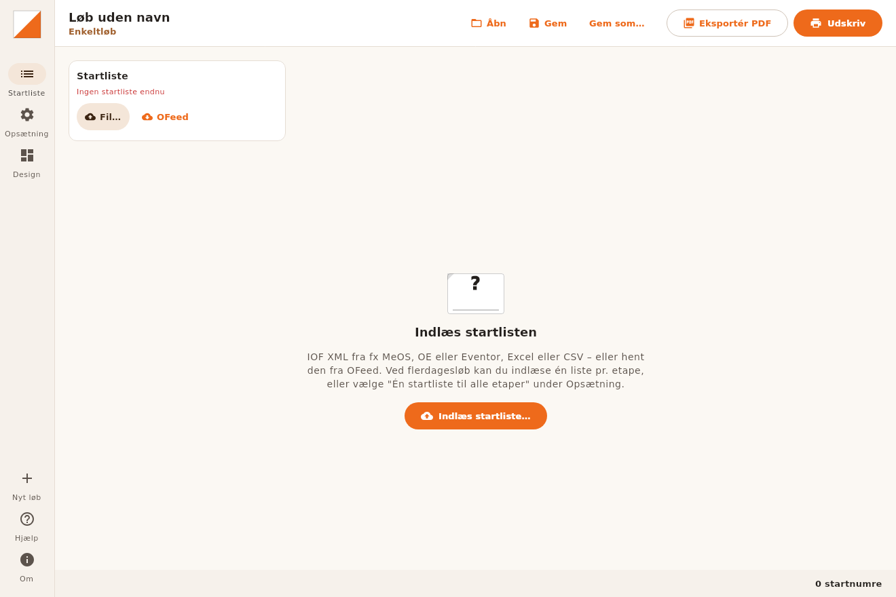

### OFeed
1. Klik **OFeed** på startlisten.
2. Indsæt **QR-linket** fra løbet på OFeed (Integrationer → O Checklist) – eller løbs-id og adgangskode.
3. Klik **Hent**.

Forbindelsen huskes – også i projektfilen. Klik **Opdater** for at hente ændringer siden sidst
(nye tilmeldinger, nye numre) uden at indsætte linket igen. Løbere du har fravalgt i tabellen,
forbliver fravalgt.

> Linket og adgangskoden gemmes i projektfilen. Giv kun projektfilen til folk, der må se løbet på OFeed.

### Tabellen

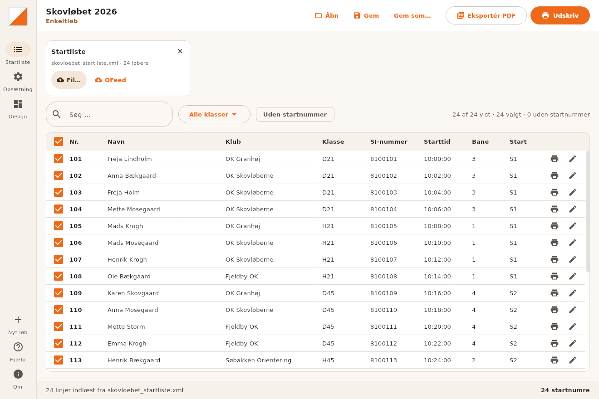
- **Søg** i navn, klub, nummer, klasse, SI-nummer, hold, bane og start (alle ord skal passe).
- **Alle klasser** – vis kun én klasse.
- **Uden startnummer** – vis kun løbere, der mangler et nummer (de står med rødt).
- **Ikke udskrevet** – vis kun dem, der ikke er udskrevet endnu (vises når noget er udskrevet).
- **Fluebenet** afgør, om løberen får et startnummer. Fluebenet i overskriften gælder alle viste –
  filtrér på en klasse først for at fravælge en hel klasse.
- **Klik på en løber** for at rette: startnummer, navn, klub, klasse, SI-nummer, starttid
  (`tt:mm` eller `tt:mm:ss`, tom = fri start), bane, start – og ved stafet hold og tur.
- **Printerikonet** udskriver kun den løber.
- Mærket **Ny** står ved løbere, der ikke er udskrevet endnu.

Løbere uden startnummer kommer ikke med i udskriften. Antallet står nederst i vinduet.

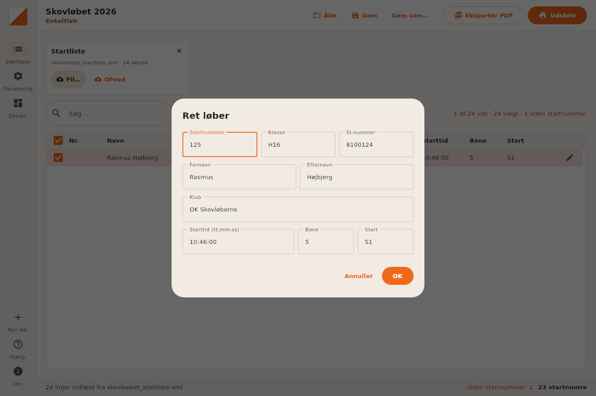

---

## 4. Opsætning af løbet

| Indstilling | Forklaring |
|---|---|
| **Løbstype** | Enkeltløb, stafet eller flerdagesløb. |
| **Løbets navn** | Hentes fra startlisten, kan rettes. |
| **Sprog på startnummeret** | Teksterne på selve nummeret ("Starttid", "Klasse" …) – 24 europæiske sprog. Uafhængigt af programmets sprog. |
| **Tidszone for starttider** | Normalt computerens. Vælg en anden, hvis startlisten er lavet i en anden tidszone. |
| **Navneformat** | "Fornavn Efternavn" eller "Efternavn, Fornavn". |
| **Antal etaper** | Flerdagesløb: 1–10. |
| **Én startliste til alle etaper** | Flerdagesløb – se [afsnit 9](#9-flerdagesløb-i-detaljer). |
| **Overskrift pr. etape** | Fx "Fredag", "Lørdag" – ellers "Etape 1", "Etape 2" … |
| **Afstand til start** | Pr. startsted (fx "S1: 400 m", "S2: 1,2 km"), plus én for øvrige startsteder. Ved flerdagesløb pr. etape. |
| **Farve pr. tur** | Stafet: farven på turbåndet og evt. nummeret. Tilføj og fjern ture. |
| **Logoer og sponsorer** | Se [afsnit 6](#6-logoer-og-sponsorer). |
| **Arkformat** | To A5 pr. A4-ark (med stiplet skærelinje) eller ét A5 pr. side. |
| **Sortering** | Startnummer, klub, klasse eller navn. |

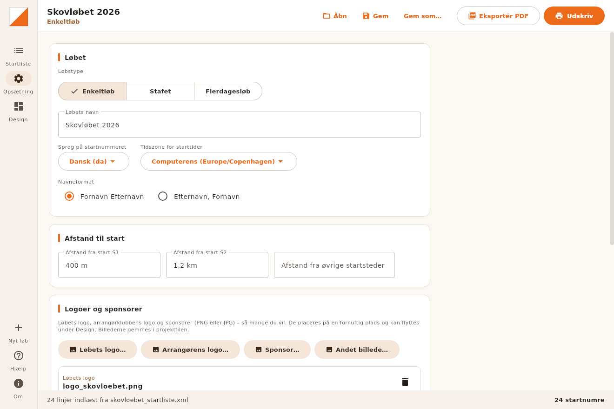

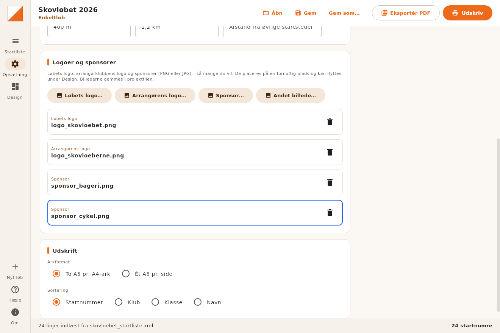

---

## 5. Design af startnummeret

Under **Design** ses startnummeret (A5 liggende, 210 × 148,5 mm) præcis som det udskrives –
forhåndsvisningen bruger samme tegning og skrifter som udskriften. Pilene under nummeret bladrer
mellem løberne; **Udskriv denne** udskriver den viste.

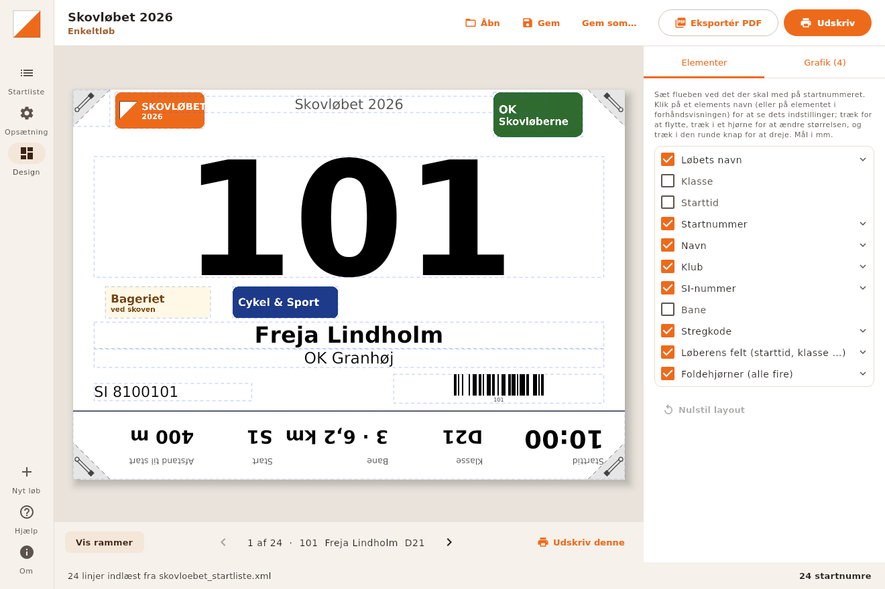

### Elementerne
Alle dele af startnummeret er elementer, der kan slås til og fra, flyttes, ændres i størrelse og
drejes:

| Element | Indhold |
|---|---|
| Løbets navn | Fra Opsætning |
| Startnummer | Stort nummer |
| Navn, Klub, Holdnavn | Løberens navn, klub; holdnavn ved stafet |
| SI-nummer | "SI 8123456" |
| Stregkode | Code 128 med nummeret (stafet: "nummer-tur", fx `568-4`), med koden i læsbar tekst under |
| Klasse, Starttid, Bane | Kan sættes på hvor som helst (fra som standard) |
| Turnummer, Turbånd, Turfarve i bunden | Stafet |
| Løberens felt | Starttid, klasse, bane, start, afstand – som standard vendt på hovedet, så løberen selv kan læse det ved at vippe nummeret op. Ved flerdagesløb én kasse pr. etape. Vælg hvilke felter der vises. |
| Foldehjørner (alle fire) | Grå hjørner med stiplet foldelinje og en lille sikkerhedsnål – se nedenfor |

### Sådan arbejder du med elementerne
- **Flueben** i listen slår elementet til og fra.
- **Klik på et elements navn** (eller på elementet i forhåndsvisningen) for at folde dets
  indstillinger ud. Klik igen for at lukke.
- **Træk** i elementet for at flytte det.
- **Træk i et hjørne** for at ændre størrelsen. Teksten skaleres til rammen.
- **Træk i den runde knap** over elementet for at dreje det. Den springer på plads ved 0°, 90°, 180°
  og 270°. Du kan også bruge **⟲ 90°** / **⟳ 90°** eller skrive vinklen.
- Ved **90° og 270°** følger teksten feltets lange side – lav fx et smalt, højt felt med løbets
  navn langs kanten.
- **Mål** (X, Y, bredde, højde) i mm fra øverste venstre hjørne.
- **Justering**: venstre, midt, højre.
- **Tekstfarve** og **baggrund**: vælg fra paletten eller skriv `#RRGGBB`. Med baggrund bliver
  teksten automatisk sort eller hvid, så den kan læses.
- **Stafet**: *Tekst i turens farve* / *Baggrund i turens farve* – nummeret skifter farve fra tur til tur.
- **Vis rammer** viser de stiplede rammer om alle elementer.
- **Nulstil layout** giver standardlayoutet for løbstypen tilbage.

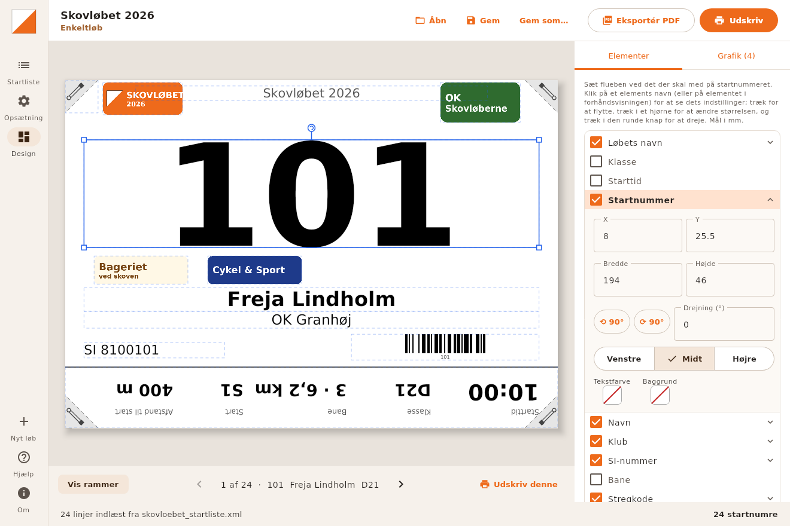

Så længe layoutet ikke er ændret, følger det automatisk løbstypen og antallet af etaper.

### Foldehjørnerne
Hjørnerne på et startnummer skal **foldes, før sikkerhedsnålen sættes i** – dobbelt papir holder
bedre og river ikke så let. Startnummeret har derfor et gråt foldehjørne i hvert af de fire hjørner
med en stiplet foldelinje og en lille sikkerhedsnål. Alle fire hjørner er ét element med én
størrelse (14 × 14 mm som standard).

---

## 6. Logoer og sponsorer

Under **Opsætning → Logoer og sponsorer** og i **Design → Grafik**:

| Knap | Standardplads |
|---|---|
| **Løbets logo…** | Øverst til venstre |
| **Arrangørens logo…** | Øverst til højre |
| **Sponsor…** | I en række over navnet – side om side, fire pr. række |
| **Andet billede…** | Øverst til venstre, forskudt |

- PNG og JPG – så mange billeder, du vil.
- Billedet skaleres ind i rammen uden at blive forvrænget.
- Billederne ligger **under teksten**, men over farvede felter (turbånd og baggrunde).
- Flyt, skalér og drej dem under Design som elementerne.
- Billederne gemmes i projektfilen.

Brug kun logoer, du har lov til at bruge (løbets, klubbens og sponsorernes egne).

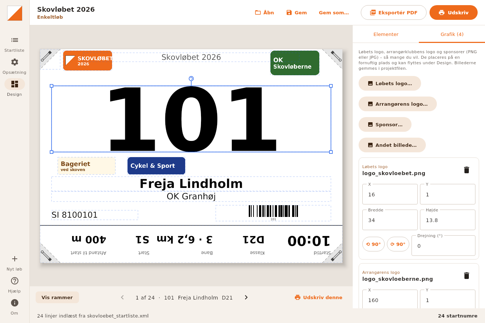

---

## 7. Udskriv og PDF

### Udskriv
Klik **Udskriv** (øverst til højre). Vælg:

- **Alle valgte løbere**
- **Kun dem der ikke er udskrevet før** – fx nytilkomne på løbsdagen
- **Kun én løber** (når du kommer fra printerikonet i tabellen eller *Udskriv denne* i Design)

og arkformatet. **Udskriv** åbner Windows' printerdialog – vælg printer og evt. antal kopier.

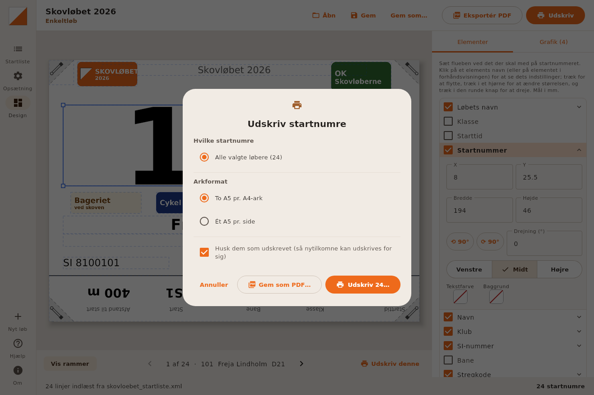

**Husk dem som udskrevet** (sat som standard) gør, at programmet ved hvad der er udskrevet. Nye
løbere får så mærket **Ny**, og nederst i vinduet står fx *"3 ikke udskrevet"*. **Glem hvad der er
udskrevet** nulstiller.

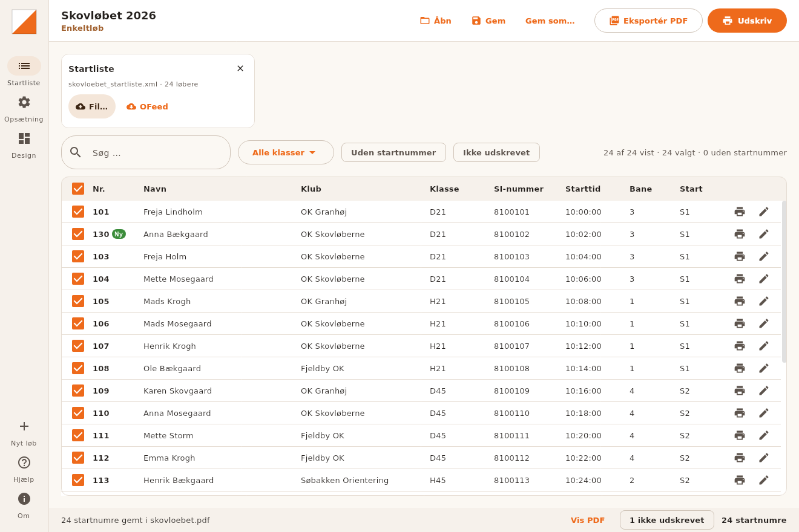

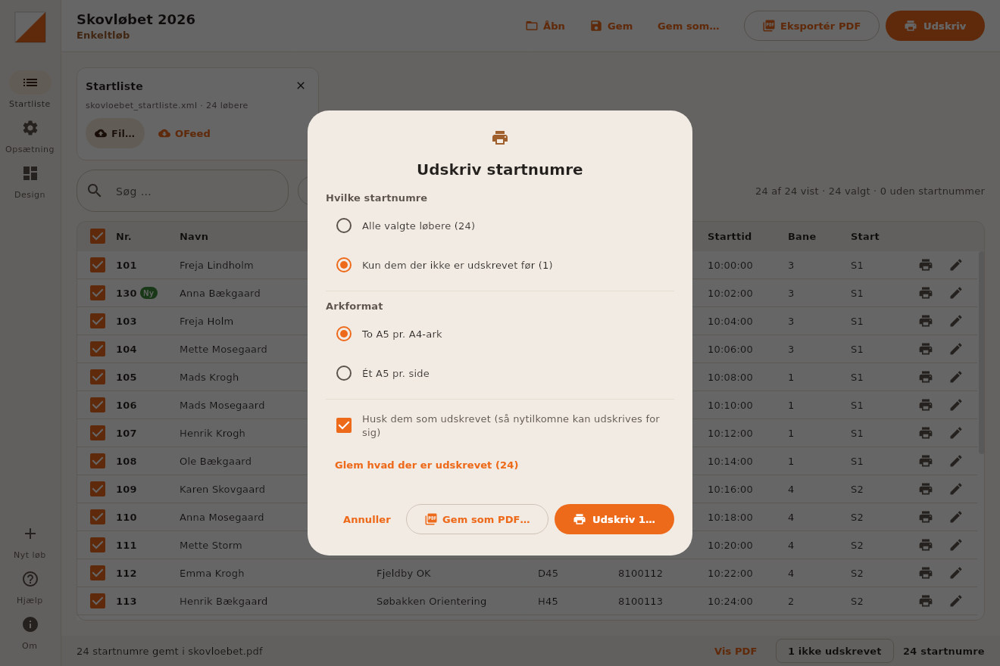

### Gem som PDF
**Eksportér PDF** (eller *Gem som PDF…* i udskriftsdialogen) gemmer det samme som en PDF-fil.
Skrifterne er indlejret, så PDF'en ser ens ud på alle computere. **Vis PDF** nederst åbner den.

### Gode råd til udskrift
- Udskriv i **100 %** (ikke "tilpas til side"), så målene passer.
- To A5 pr. A4: skær langs den stiplede linje midt på arket.
- Tykkere papir (fx 120–160 g) eller vandfast papir holder bedre i regn.

---

## 8. Projektfilen – gem, åbn og giv videre

**Gem** gemmer **alt** i én fil (`.json`):

- opsætningen og designet (elementer, farver, drejning)
- startlisterne med dine rettelser og fravalg
- hvad der er udskrevet
- OFeed-forbindelsen (link og adgangskode)
- selve billederne (logoer, sponsorer)

Filen kan **gives videre** – fx til en anden i arrangørgruppen – og åbnes på en anden PC med alt
på plads. Billederne pakkes ud i `%LOCALAPPDATA%\BiNumreGenerator\grafik`.

Titellinjen viser *"ikke gemt"*, når der er ændringer. Lukker du programmet med ændringer, spørger
det om du vil gemme.

> Projektfilen indeholder OFeed-adgangskoden og løbernes navne. Del den kun med folk, der må se dem.

---

## 9. Flerdagesløb i detaljer

### Én startliste pr. etape
Hver etape har sin plads på startlisten (*Etape 1*, *Etape 2* …). Klik **Fil…** på etapen. Vælger
du flere filer på én gang, fylder de de følgende etaper. Mangler en etape, står den som "–" på
startnummeret, indtil den indlæses.

### Én startliste til alle etaper
Slå **Én startliste til alle etaper** til under Opsætning. Én fil bruges til alle etaper:

- Har filen en start pr. etape (IOF XML med `raceNumber`, fx fra MeOS), får hver etape sin egen
  starttid, bane og start.
- Ellers bruges samme oplysninger på alle etaper.

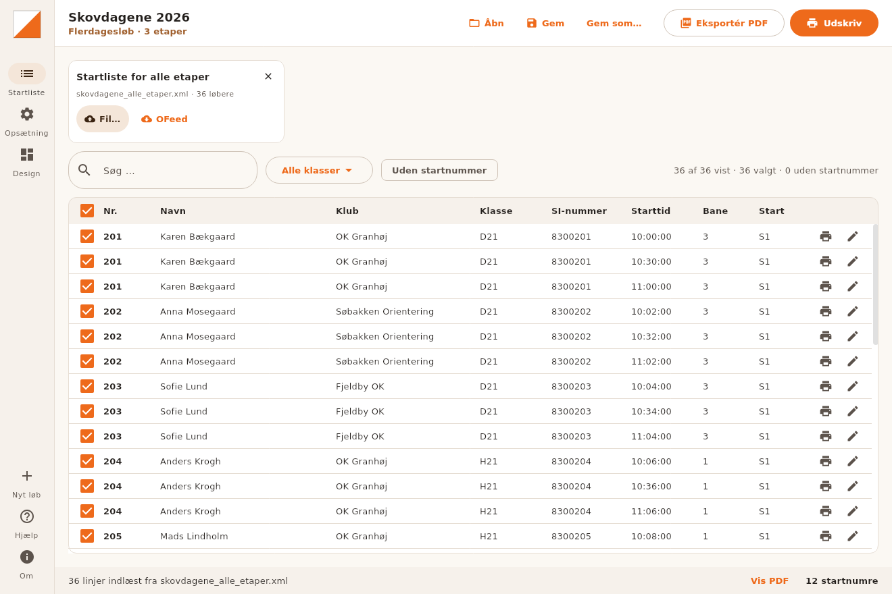

### Samme løber på tværs af etaper
Løberne matches i denne rækkefølge:

1. **samme startnummer**
2. ellers **samme SI-brik**
3. ellers **samme navn og klub**

Står nummeret kun i én etapes liste, vises det i gråt i de andre etapers tabel – løberen har det
stadig.

### Løberens felt
Ved flerdagesløb er løberens felt **én kasse pr. etape side om side** med etapens overskrift,
starttid, klasse · bane og start · afstand.

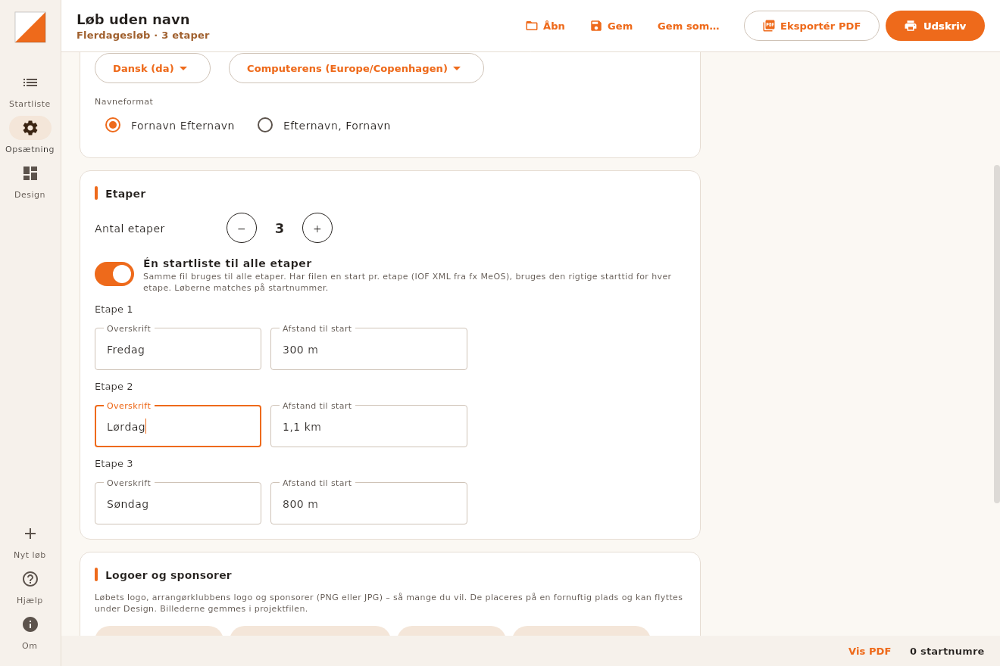

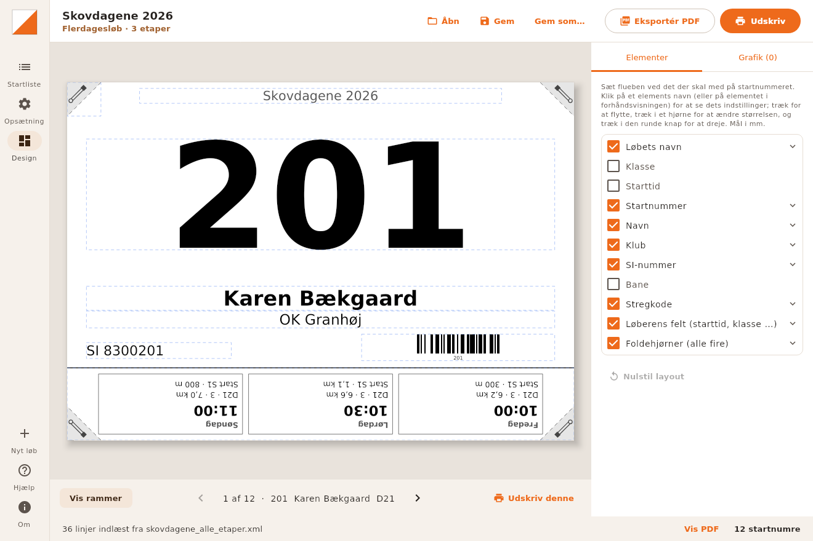

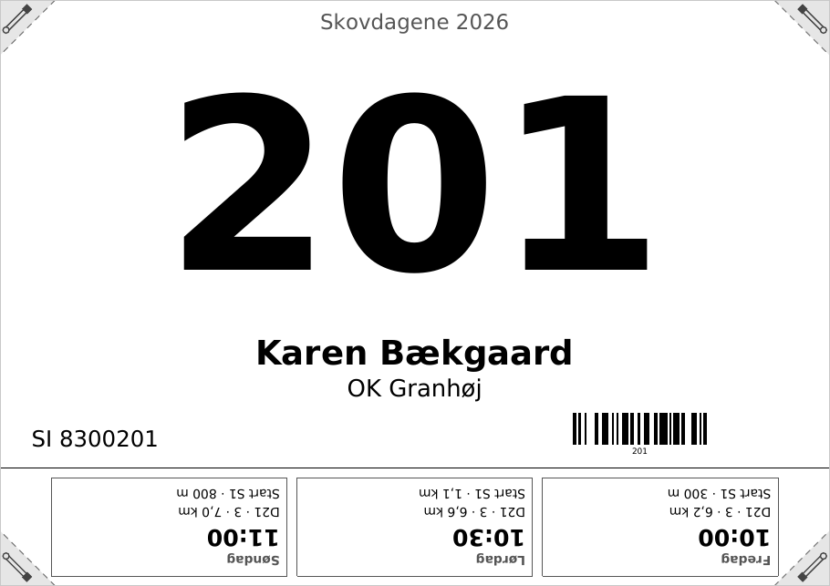

---

## 10. Stafet i detaljer

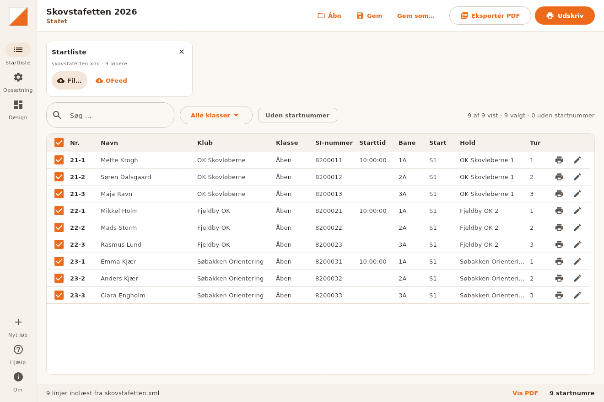

- Holdets ture har **samme startnummer**. Numre som `12.1`, `12-1` og `12/1` bliver til `12`, når
  tallet efter tegnet er turen.
- Turen vises i et **farvet bånd** ("Tur 1") og en **farvet stribe** i bunden – farve pr. tur under
  Opsætning.
- **Kun 1. tur har starttid** – de næste ture starter, når holdkammeraten kommer i mål.
- **Turnummer** kan sættes på som et stort tal (fx i hjørnet).
- Nummeret og andre elementer kan få **turens farve** som tekst eller baggrund.
- **Holdnavnet** vises i stedet for klubben (kan ændres).
- Stregkoden indeholder `nummer-tur`, fx `12-2`.

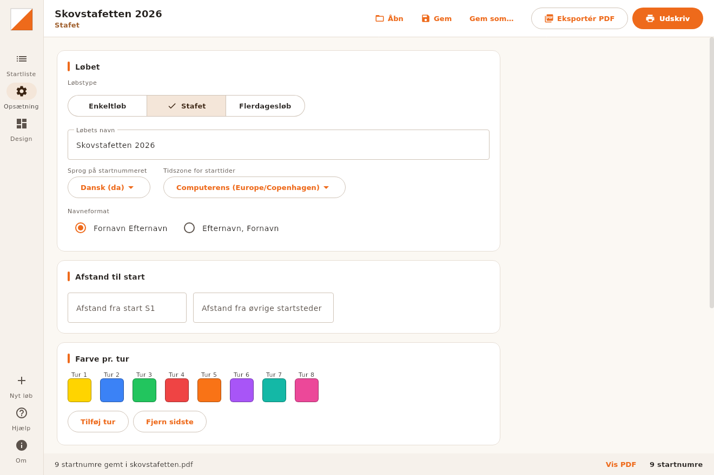

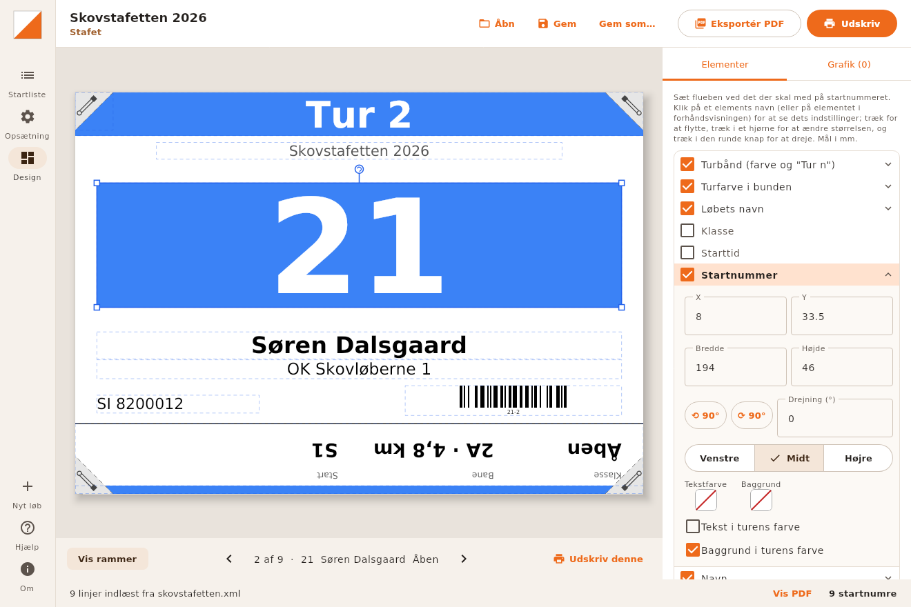

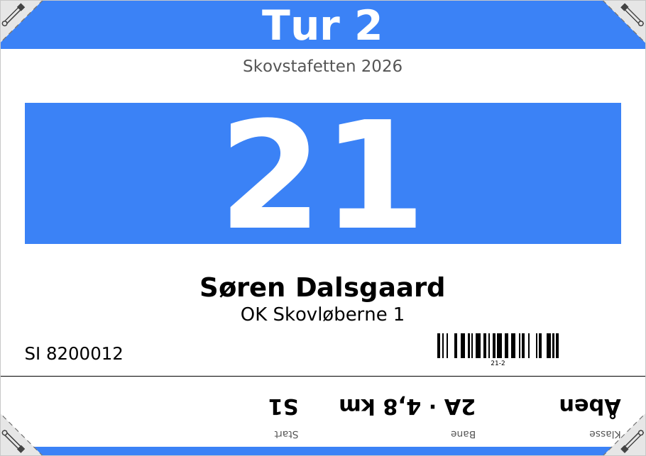

---

## 11. Sprog

- **Programmets sprog** følger Windows' sprog (dansk eller engelsk; andre sprog vises på engelsk).
- **Startnummerets sprog** vælges under Opsætning – 24 europæiske sprog: dansk, engelsk, svensk,
  norsk, finsk, tysk, hollandsk, fransk, spansk, portugisisk, italiensk, polsk, tjekkisk, slovakisk,
  slovensk, kroatisk, ungarsk, rumænsk, bulgarsk, græsk, estisk, lettisk, litauisk og ukrainsk.

Oversættelser af programmet til flere sprog modtages gerne.

---

## 12. Spørgsmål og fejlfinding

**"Windows beskyttede din pc"**
Programmet er ikke kodesigneret endnu. Klik *Flere oplysninger* → *Kør alligevel*.

**Programmet starter ikke fra zip-filen**
Pak hele zip-filen ud først og start `Start BiNumreGenerator.bat` eller `Program\BiNumreGenerator.exe`.

**"Der er ingen printer på computeren"**
Tilføj en printer i Windows – eller brug *Gem som PDF*.

**Nogle løbere får ikke et startnummer**
De mangler et nummer i startlisten (rød i tabellen) eller er fravalgt. Klik på løberen og skriv
nummeret, eller ret det i løbsprogrammet og indlæs igen.

**Starttiderne er forskudt en eller flere timer**
Vælg den rigtige tidszone under Opsætning.

**Et logo vises som et rødt felt i Design**
Billedfilen findes ikke længere. Indsæt den igen (i nye projektfiler ligger billederne i filen).

**Teksten er for stor eller lille på startnummeret**
Ændr højden på elementets ramme (Design) – teksten skaleres med.

**OFeed afviser løbs-id eller adgangskode**
Brug QR-linket fra løbet på OFeed (Integrationer → O Checklist) – så er alt med.

**Hvordan får jeg en ny version?**
*Hjælp* → *Søg efter ny version* åbner hjemmesiden. Hent den nye pakke og pak den ud. Dine
projektfiler kan bruges i den nye version.

---

## 13. Kommandolinje (for øvede)

Programmet kan også lave PDF uden at åbne vinduet. Uden argumenter åbner vinduet.

```
BiNumreGenerator startliste.xml -o numre.pdf --distance S1=400m --distance S2=1,2km
BiNumreGenerator stafet.xml --type relay --lang sv
BiNumreGenerator etape1.xml etape2.xml --stage Lørdag --stage Søndag --distance 1:400m --distance 2:S1=600m
BiNumreGenerator alle_etaper.xml --type multiday --stage Fre --stage Lør --stage Søn
BiNumreGenerator --project loeb.json            (bruger startlisterne i projektfilen)
BiNumreGenerator --ofeed "<QR-link>" --project loeb.json
BiNumreGenerator --gui startliste.xml           (åbner vinduet med startlisten)
BiNumreGenerator --help
```

| Valg | Betydning |
|---|---|
| `-o, --out <fil>` | PDF-filen (standard `startnumre.pdf`) |
| `--project <fil>` / `--save-project <fil>` | Brug / gem projektfil |
| `--type single\|relay\|multiday` | Løbstype |
| `--ofeed <link\|løbs-id>` `--password <kode>` | Hent fra OFeed |
| `--event <navn>` | Løbets navn |
| `--lang <kode>` | Startnummerets sprog (`da`, `en`, `sv`, `nb`, `de` …) |
| `--sheet a4x2\|a5` | Arkformat |
| `--sort bib\|club\|class\|name` | Sortering |
| `--class <klasse>` | Kun denne klasse (kan gentages) |
| `--distance [etape:][start=]tekst` | Afstand til start |
| `--stage <tekst>` | Etapens overskrift (gentages) |
| `--zone <tidszone>` | Fx `Europe/Copenhagen` |

På Windows har `.exe`-filen ikke et konsolvindue, så udskrifterne fra kommandolinjen ses ikke dér –
PDF'en laves stadig.

---

## 14. Ophavsret, licenser og sikkerhed

**Copyright © 2026 David S. Palsgaard. Alle rettigheder forbeholdes.**
Se `LICENS.txt` i pakken og *Om* i programmet.

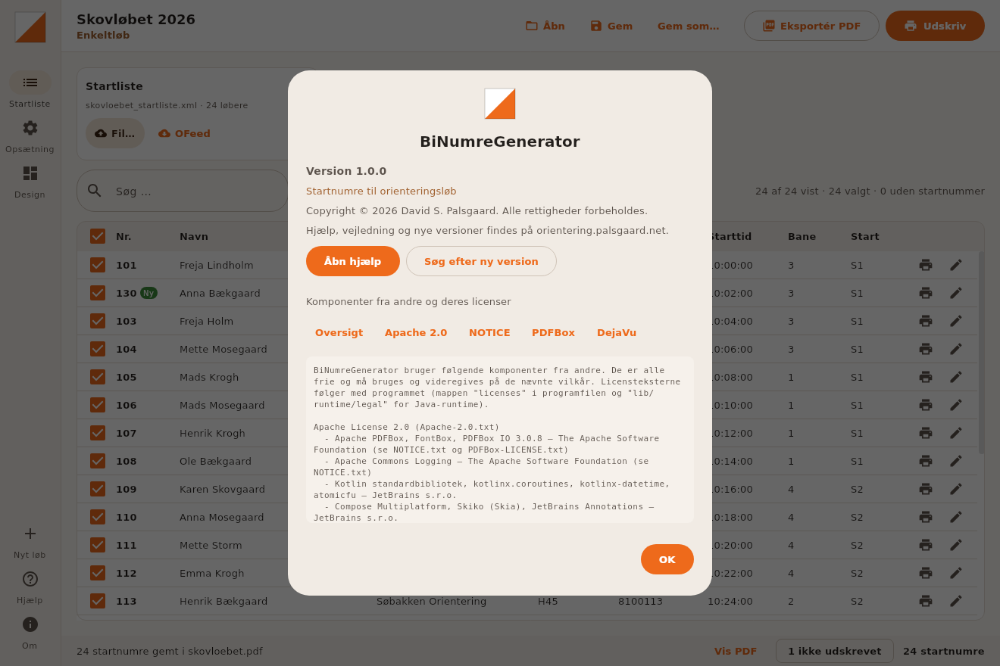

Programmet bruger komponenter fra andre under frie licenser – oversigten og licensteksterne ligger
i mappen `Licenser` og under *Om*:

| Komponent | Licens |
|---|---|
| Apache PDFBox, FontBox, Commons Logging | Apache 2.0 |
| Kotlin, kotlinx, Compose Multiplatform, Skiko, AndroidX, Material-ikoner | Apache 2.0 |
| Skia | BSD 3-Clause |
| JSON in Java (org.json) | Public Domain |
| DejaVu Sans (skrifterne på startnummeret) | Bitstream Vera / DejaVu-licensen |
| Java-runtime (OpenJDK, Eclipse Temurin) | GPLv2 med Classpath Exception (licenser i `lib\runtime\legal`) |

### Sikkerhed og data
- Programmet sender kun data ud, når du henter fra **OFeed**. Adgangskoden sendes krypteret (HTTPS)
  og kun til OFeed-serveren.
- **Hjælp** og **Søg efter ny version** åbner hjemmesiden i din browser – programmet henter ikke
  selv noget.
- Startlister og projektfiler fra andre læses sikkert: XML-filer kan ikke hente eksterne filer,
  Excel-filer og billeder har størrelsesgrænser, og billeder pakkes kun ud som PNG/JPG i
  programmets egen mappe.
- Projektfilen indeholder navne, klubber, SI-numre og evt. OFeed-adgangskoden. Behandl den som
  persondata, og slet den, når løbet er afviklet og ikke skal bruges mere.

---

## 15. For udviklere

### Skærmbilleder og eksempeldata
Skærmbillederne i denne hjælp ligger i `docs/billeder/` og er lavet med opdigtede data (løbere, klubber,
løb og logoer) fra `docs/eksempeldata/` – de kan også bruges til at afprøve programmet.

### Kildekode og bygning
- Kildekoden ligger på GitHub: `DavidSPalsgaard/BiNumberGenerator`.
- Kotlin, Gradle, Compose Multiplatform (desktop). Kræver JDK 17+ for at bygge – ikke for at køre
  den færdige pakke.

```
gradlew :core:test :desktop:test        # tests
gradlew :desktop:run                     # start programmet
gradlew :desktop:createDistributable     # mappe med BiNumreGenerator.exe og indbygget Java
gradlew :desktop:packageMsi              # installationsfil (kun på Windows)
```

- GitHub Actions (`.github/workflows/build.yml`) bygger og tester på Windows ved hver ændring på
  `main` og lægger `BiNumreGenerator-testpakke.zip` under **Releases → Seneste udgave**.
- Versionen sættes i `desktop/build.gradle.kts` (`appVersion`).

### Opbygning
| Modul / mappe | Indhold |
|---|---|
| `core/startlist/` | Indlæsning af IOF XML 3.0/2.0.3, Excel, CSV; startlister som JSON |
| `core/ofeed/` | OFeed: link, hentning, ændringer siden sidst |
| `core/model/` | Projekt (`BibProject`), elementer, grafik, startnumre (`BibBuilder`: enkeltløb, stafet, flerdagesløb og matchning) |
| `core/layout/` | Tegning i mm mod `BibCanvas` (`BibLayout`), flyt/skalér/drej (`GraphicEdit`), Code 128, tekster på 24 sprog |
| `desktop/` | PDF (`PdfWriter`, PDFBox), skærm (`SkiaBibCanvas`), udskrift (`Printer`), projektfil (`ProjectFiles`), kommandolinje (`Main.kt`) og brugerflade (`ui/`) |
| `desktop/src/main/resources/i18n/` | Programmets tekster (`da.properties`, `en.properties`) |
| `desktop/src/main/resources/licenses/` | Licenser og NOTICE for tredjepartskomponenter |
| `desktop/icons/` | Programikonet (`lav_ikon.py` tegner det) |
| `testpakke/` | Testfiler og testvejledning til testpakken |

`core/` er uden afhængighed af Compose og PDFBox, så en Android-app senere kan bruge den med sin
egen `BibCanvas`.

### Startnummerets mål
A5 liggende: 210 × 148,5 mm. Alle mål i projektfilen er i mm fra øverste venstre hjørne; vinkler i
grader med uret om rammens midte.

### Projektfilens indhold (JSON)
`type`, `eventName`, `language`, `nameFormat`, `sheet`, `sortBy`, `zone`, `legColors`, `stages`
(overskrift og afstande pr. startsted), `elements` (`kind`, `x`, `y`, `width`, `height`, `visible`,
`rotation`, `align`, `color`/`background` som `#RRGGBB` eller `leg`), `graphics` (`file`, mål,
`role`, `rotation`, `data` = billedet i base64), `infoFields`, `sharedStartList`, `printed`,
`ofeed`, `startLists`.

### Oversæt programmet
Kopiér `desktop/src/main/resources/i18n/en.properties` til `<sprogkode>.properties` (fx
`sv.properties`), oversæt teksterne og gem som UTF-8. Sproget bruges automatisk på computere med
det sprog. Manglende tekster vises på engelsk.

### Planer
- Direkte forbindelse til MeOS
- Kodesignering af Windows-pakken
- Pakker til Linux og Mac
- Android-app (genbruger `core/`)
